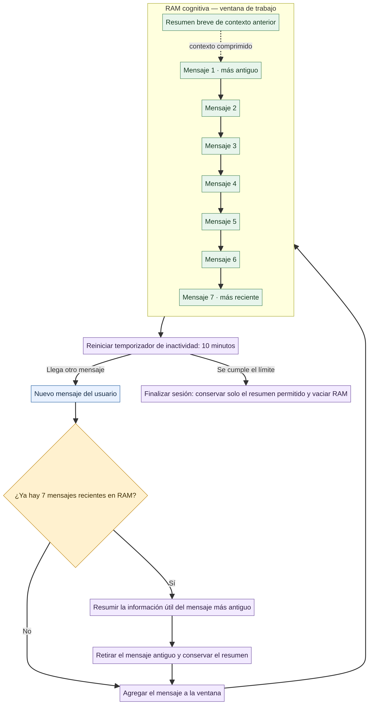

# Fase 3 — Semana 8: La RAM cognitiva

## Memoria de trabajo y carga cognitiva

Para este diseño, la RAM representa el contexto temporal que el asistente necesita para mantener coherencia durante una conversación activa. La consigna menciona el número mágico **7±2** como referencia para la memoria de trabajo. No significa que un modelo de IA solo pueda procesar siete mensajes; es una pauta didáctica para definir una ventana pequeña, explícita y manejable.

### Decisión para el proyecto

- **Límite de la ventana:** conservar los **7 mensajes más recientes** (del usuario y del asistente) en RAM.
- **Cuando entra el octavo mensaje:** resumir los detalles útiles del mensaje más antiguo, quitarlo de la secuencia literal y conservar el resumen junto con los siete mensajes recientes.
- **Qué se conserva en el resumen:** objetivo de estilo, preferencias expresadas, datos de cabello/rostro que el usuario haya compartido y preguntas pendientes necesarias para continuar.
- **Qué no se guarda por defecto:** fotografías crudas, datos sensibles ni inferencias sobre identidad. La memoria a largo plazo solo debe guardar preferencias duraderas con consentimiento.
- **Límite temporal:** reiniciar el temporizador con cada mensaje; tras **10 minutos de inactividad**, se aplica la regla de cierre de la Semana 9.

Así, el bot deja de conservar el inicio de la conversación como texto literal cuando la ventana se llena, pero no pierde todo el hilo: reemplaza lo antiguo por un resumen breve. El límite de siete es una decisión de diseño para el proyecto; el límite real de tokens del modelo es una restricción técnica diferente.

## Diagrama de la ventana de contexto

Fuente editable: [`ventana-contexto.mmd`](diagramas/ventana-contexto.mmd).

## Relación con el material existente

El README tenía un prototipo con `MAX_TURNOS_RAM = 30` y conservaba los últimos diez mensajes al comprimir. Esta entrega establece una regla más clara para la actividad: siete mensajes recientes como ventana explícita, más un resumen breve de lo anterior. La expiración de diez minutos ya aparecía en el código como `RAM_TTL_SECONDS = 600`; se conserva ese valor.
