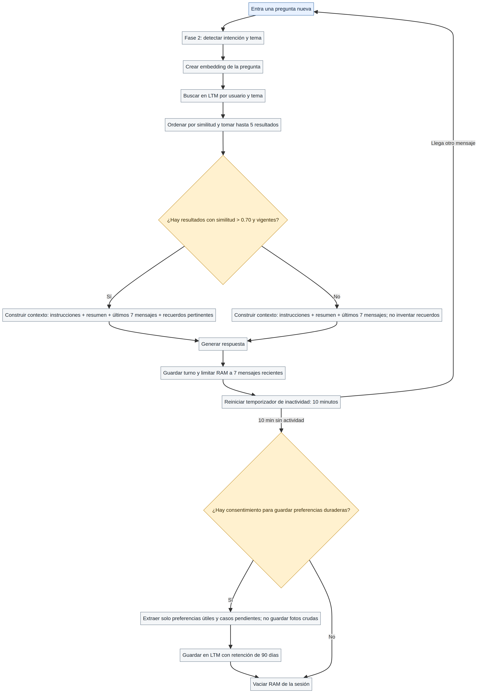

# Fase 3 — Semana 9: El Bibliotecario

## Procesos de recuperación y olvido

La Semana 9 conecta la pregunta entrante (clasificación de la Fase 2) con la recuperación de recuerdos pertinentes en la memoria a largo plazo (LTM), y define cómo termina una sesión inactiva.

### Flujo de recuperación

1. Recibir la pregunta y detectar intención/tema.
2. Crear su embedding y buscar registros del mismo usuario, filtrando por tema cuando esté disponible.
3. Ordenar por similitud y traer hasta **5 recuerdos**; se conservan el umbral y el `TOP_K_LTM = 5` del prototipo actual (similitud estrictamente superior a `0.70`).
4. Usar solo recuerdos vigentes y pertinentes. Si no hay resultados, responder con el contexto actual sin inventar recuerdos.
5. Construir el prompt con instrucciones, el resumen de contexto y los **7 mensajes recientes** de RAM, más los recuerdos recuperados.
6. Generar la respuesta, guardar el nuevo intercambio en RAM y reiniciar el temporizador de inactividad de 10 minutos.

### Regla de olvido

- Con cada mensaje se renueva el temporizador.
- Si pasan **10 minutos sin actividad**, finalizar la sesión y vaciar la RAM.
- Antes de borrar, guardar en LTM únicamente preferencias de estilo realmente útiles o asuntos pendientes que el usuario haya consentido recordar. No guardar fotos crudas ni detalles sensibles por defecto.
- Los recuerdos de LTM conservan la retención de **90 días** que ya aparece en el prototipo; después se purgan.
- Sin consentimiento para memoria duradera, no escribir en LTM: simplemente borrar la RAM temporal al vencer la sesión.

### Diagrama de recuperación y olvido

Fuente editable: [`recuperacion-olvido.mmd`](diagramas/recuperacion-olvido.mmd).

## Qué encontré y qué queda corregido

**Ya estaba en el README:** el límite temporal de 600 segundos, la búsqueda LTM filtrada por usuario/tema, `TOP_K_LTM = 5`, el umbral de similitud `> 0.70`, la retención de 90 días y una función llamada `al_expirar_sesion` para resumir la conversación.

**Faltaba:** una ventana de memoria de trabajo alineada con la consigna; un diagrama de recuperación/olvido; y la conexión operativa entre el vencimiento de RAM y la función de guardado. El código define `al_expirar_sesion`, pero no muestra quién la invoca antes de que Redis elimine la clave.

**Nota de implementación:** Redis elimina una clave al vencer el TTL, pero ese vencimiento por sí solo no ejecuta una función de Python. Para cumplir el flujo dibujado, un temporizador de la aplicación debe invocar `al_expirar_sesion` antes de que desaparezca la clave; si solo se usa TTL, la RAM se borra, pero no se guarda el resumen en LTM. El diagrama documenta el comportamiento esperado, no afirma que ese disparador ya esté desplegado.

## Criterios de aceptación

- [x] La ventana RAM tiene un límite definido: siete mensajes recientes y un resumen de lo anterior.
- [x] La búsqueda recupera hasta cinco recuerdos pertinentes del mismo usuario con similitud `> 0.70`.
- [x] La sesión se considera inactiva después de diez minutos.
- [x] Se separa el borrado de RAM de la decisión de conservar algo en LTM.
- [ ] Conectar el finalizador a un disparador real en el programa cuando se implemente el backend.
